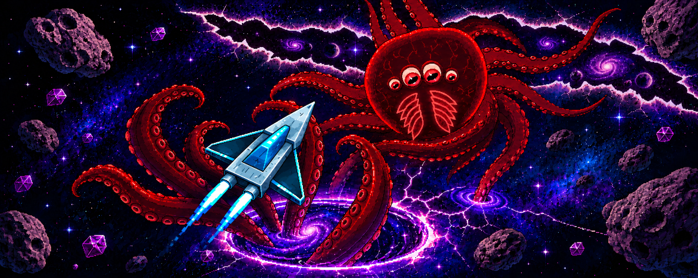
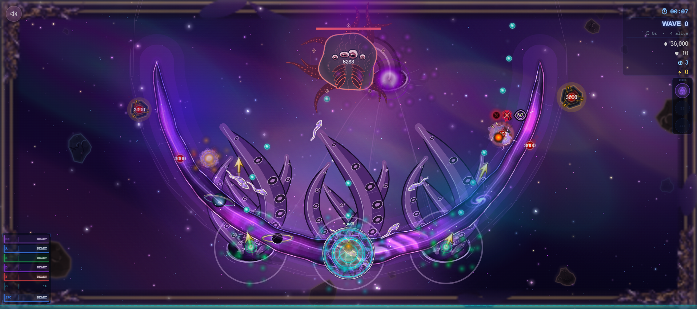

# Pisces: Space Journey

> *The Virtual Cosmos is under siege. Entities of pure information, born of the most advanced civilizations across countless worlds, have poured through every gate and swallowed the stars in silence. One ship still stands against them: the Pisces Interceptor, small against the tide but armed with the powers of the Zodiac Sigils. Every wave you survive is a breath won back from the void. Fight on, pilot, until the very last second.*

[](https://aansensei.dev/space-shooter/)
[](LICENSE)


[](https://github.com/aansensei/space-shooter/commits/main)

**Author:** An Nguyen

**License:** [PolyForm Noncommercial 1.0.0](LICENSE). Commercial use is not permitted under this license.

**Play the game:** [https://aansensei.dev/space-shooter/](https://aansensei.dev/space-shooter/)

## What is this

Pisces: Space Journey is a fast-paced arcade space shooter with deep combat mechanics, percentage-based damage scaling, and powerful screen-clearing abilities. You fly a lone interceptor through endless enemy waves, build a loadout from Zodiac Sigils, manage your cooldowns, and go for the highest score.

It is a hobby project made for the love of the genre. The bullet-hell spirit (a tiny visible hitbox, dense patterns you read and weave through, bosses with telegraphed attacks) is inspired by shooters such as Touhou Project, then pushed toward its own idea: a ship that grows into a whole squad of Sentinels, skills that rewrite the battlefield, and bosses with their own rules.

## At a glance

| | |
|---|---|
| **Genre** | Arcade space shooter, with bullet-hell influences |
| **Play on** | Any modern browser, desktop or phone. No install and no account. Optional install as an offline web app |
| **Languages** | English and Tiếng Việt, switchable in Settings |
| **Modes** | Endless Voyage, a guided Tutorial with Kanade, and a Custom Voyage sandbox |
| **Cost** | Free and non-commercial. No ads, no sales |
| **Built with** | Plain JavaScript, HTML5 Canvas and WebGL (PixiJS). No framework, no bundler, no backend |



## Features

- **Ten boss-class enemies.** Veilshroud, Uriel, Thaelis, Raphael, Marchosias, Egregor, Ammit, Dargruel, Leviathan and Goliath each break a different rule: barriers, shields that heal, rifts, gateways, waves you must read.
- **Zodiac Sigils.** At waves 5 and 10 you pick from a pool of sigils (the twelve Western zodiac signs plus a growing Vietnamese zodiac set). Each one grants two permanent buffs and changes how you play.
- **Skills and Sentinels.** Six active skills on the keyboard, and Sentinels that join you, throw golden spears and form a network that shares damage.
- **Readable danger.** Every strong area attack shows the same warning language: a zone, a closing ring and a tick clock. Enemy bullets always sit on top and glow, so dense screens stay fair.
- **Timeline Distortion.** Boss waves bend the rules of the run for a while.
- **A guided start.** The Tutorial teaches movement, every skill and how to read warnings, and awards a Voyage Pilot Licence you can save as an image.
- **Smooth on modest hardware.** Five graphics levels, a Smart Quality mode that adjusts itself, and switches for each heavy effect.

## How to Play

| Input | Action |
|---|---|
| ← → Arrow Keys | Move left / right |
| Spacebar (tap & hold) | Charge shot — release to fire |
| Spacebar (hold 3 seconds) | Overload Laser |
| Shift Left / Right | Skill: Yog-Sothoth Domain |
| A | Skill: Thunder Orbs |
| S | Skill: Remembrance Spirit / Primeval Creation |
| D | Skill: Death Star |
| F | Skill: Annihilation Sweep |
| G | Skill: Life Domain / Tesla Matrix |

- You start with **10 lives**. Earn **+1 life** every **500,000 points**, up to a maximum of **12**.
- Your ship fires automatically at all times.
- A small **cyan hitbox dot** at the exact center of your ship shows the true collision point — only that dot touching a bullet costs a life.
- Enemy bullets always render on top of all effects and are outlined with a **pulsing white glow** so they remain visible in dense situations.
- The game automatically **pauses** if you switch tabs, and resumes cleanly with no time skips.
- The bar above **Initiate Hyperjump** picks the voyage: **Endless Voyage** is the standard run, **Tutorial** is a short guided lesson with Kanade that teaches movement, every skill and how to read attack warnings, and **Custom Voyage** is the debug sandbox (it opens the debug console, and on the live site the backquote key answers only while Custom Voyage is chosen).

Tutorial awards a bilingual Voyage Pilot Licence after a clean pass through every dodge lesson. The licence records calibration results and can be saved as a PNG.

## Want to know more about the gameplay

This page only covers the basics. Every rule is written down in **[game_logic.md](game_logic.md)**: Settings, General Combat Rules, Player Stats and Attacks, Passive Abilities, Active Skills, Sigils, every enemy and boss, the Enemy Class System, the Spawn System, and the Administrator Class. The in-game Guide is built from the same material.

## Under the hood

Everything runs in the browser. These are the techniques the game uses:

| Area | What the game uses |
|---|---|
| **Rendering** | Canvas 2D for the gameplay layers and WebGL through PixiJS 8 for the background and overlay layers. Many sprites are baked once into offscreen canvases instead of being redrawn path by path every frame |
| **Performance** | Five graphics levels (full, medium, low, minimum, performance) with a Smart Quality mode that adapts on its own, particle pooling, a phone tier that trims heavy effects, and a frame cap with a High FPS option on mobile |
| **Audio** | Web Audio API with decoded buffers, gapless loops, a ducking filter, positional volume that fades with distance, and a BGM playlist you can filter |
| **Offline and install** | A service worker with a versioned, cache-first store, a precached app shell, optional offline packages from Settings, and a web app manifest so it installs like an app |
| **Input** | Keyboard and touch controls, vibration feedback on phones, and an automatic pause when the tab is hidden |
| **Saved data** | Settings and preferences are kept locally in the browser (localStorage). Nothing is sent to a server |
| **Localization** | Full English and Vietnamese text, switched at runtime |
| **Code layout** | Plain scripts that share one global namespace and load in a fixed order from index.html. One file per boss, per skill and per sigil, so a mechanic can be changed in one place |
| **Testing** | Headless browser scripts that step the game frame by frame to check combat rules, audio calls and effects, and measure draw cost (kept in `misc/dev-tools`) |

## Run it locally

There is no build step and nothing to install. Serve the folder with any static server and open it in a browser:

```bash
npx serve . -l 8123
```

Then open `http://localhost:8123`. Use a server rather than opening the file directly, because the service worker and the offline features need `http://localhost` or `https`.

## Project structure

```text
index.html              the game shell, loads every script in a fixed order
guide.html              the in-game Guide, Update Log and Music Archive
sw.js                   service worker for offline play
manifest.json           web app manifest
css/                    style.css, recap.css
js/
  config.js             shared state and constants, loads first
  main.js               game loop, spawning and enemy updates
  audio.js              Web Audio manager (music, effects, loops)
  input.js              keyboard and touch input
  pixi-renderer.js      WebGL layer, with background.js for the backdrop
  recap.js, tutorial.js, offline.js, ...   Voyage Recap, Tutorial, offline packages and other screens
  entities/             enemy and ally logic, one file per boss
  render/               drawing code, one file per enemy plus shared effects
  skills/               player skills and sigil mechanics
  sigils/               sigil definitions, one file per sigil
  vendor/               PixiJS (MIT licensed)
assets/                 images, audio and video
game_logic.md           the full game rules: skills, sigils, enemies, spawning
misc/                   development tools and test scripts
LICENSE, LICENSES/, THIRD_PARTY_NOTICES.md
```

The folder `js/` has its own [README](js/README.md) with notes on the module layout.

## Inspiration, references and disclaimer

This is a personal learning project and a labor of love. Its ideas, visuals and mechanics are referenced and adapted from many different sources, such as shooters (Touhou Project among them), other games, anime, films and mythology, then reworked for this project. No single work is copied, and any resemblance to existing material is inspiration, not a claim of ownership.

Pisces: Space Journey is fan made and is not affiliated with, endorsed by, or sponsored by any studio, publisher, record label, artist, or owner of any franchise, character or brand it may resemble. Every trademark, name and work mentioned or echoed here belongs to its respective owner.

This is a personal learning project for practising game development. It draws on multiple tutorials, documentation, code examples, and artistic and gameplay references. It is shared for learning, experimentation, and noncommercial enjoyment.

Đây là dự án học tập cá nhân, có tham khảo nhiều nguồn tài liệu, hướng dẫn, ví dụ mã nguồn và ý tưởng hình ảnh, lối chơi. Dự án được chia sẻ để học hỏi, thử nghiệm và giải trí phi thương mại.

The project license applies only to material owned by the project author. Third-party code, images, audio, fonts, characters, and other referenced material remain subject to their respective owners' rights and original license terms. Their inclusion does not claim ownership or grant additional rights. See [third-party notices](THIRD_PARTY_NOTICES.md).

Commercial use of the author's material requires separate permission from the author. This license change does not withdraw permissions already granted for copies previously distributed under MIT.

## License

Released under the [PolyForm Noncommercial License 1.0.0](LICENSE). Third-party material is listed in [THIRD_PARTY_NOTICES.md](THIRD_PARTY_NOTICES.md), and the full upstream licenses are in the [LICENSES](LICENSES) folder.

## Contact

Questions, bug reports, or just want to say hi? Find me on GitHub: [@aansensei](https://github.com/aansensei). If anything here ever crosses a line unintentionally, reach out and it will be corrected or removed promptly.
